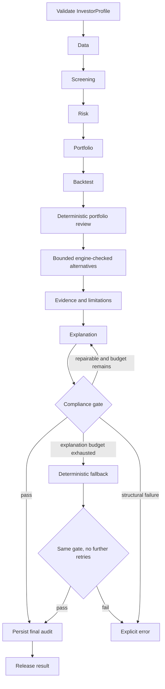

# File-based agent workflow

## What the files do

The root `AGENTS.md` is a development router. It selects specialist playbooks under `agents/<role>-agent.md` according to a coding request. The current assistant can perform multiple roles sequentially. Separate subagents require an execution facility and permission to delegate; these files do not register or launch them.

Codex discovers instruction files along the project-root-to-working-directory path. The named specialist files are not automatically discovered as AGENTS.md instructions. The root router therefore explicitly reads the selected files. Start a new session at this inner Git repository to load the new root guidance. If your workspace is the outer directory, explicitly ask the assistant to read `RecommenDathon/AGENTS.md` first or open the inner repository.

Source: [Official OpenAI documentation: AGENTS.md discovery](https://learn.chatgpt.com/docs/agent-configuration/agents-md).

## Request routing

| Example call | Selected roles | Expected development output |
| --- | --- | --- |
| "Fix CAD conversion and missing FX handling" | data, infrastructure, evidence | Loader change, manifest method, targeted checks |
| "Add ticker exclusions" | screening, portfolio, compliance | Exclusion rule, feasibility and constraint checks |
| "Change volatility calculation" | risk, data | Documented convention, known-series verification; identify downstream invalidation |
| "Implement a crypto weight cap" | portfolio, screening, compliance | Aggregate cap, infeasible-case handling, checks |
| "Implement the historical simulation" | backtest, data, portfolio | Simulation with timing and allocation assumptions |
| "Explain why an asset was rejected" | explanation, evidence; portfolio if record absent | Cited actual rejection reason or explicit missing evidence |
| "Fix hallucinated figures" | evidence, explanation, compliance | Claim validation, bounded repair and checked fallback |
| "Save the run to S3" | infrastructure | Audit adapter and failure handling |
| "Build the full recommendation pipeline" | all pipeline roles, infrastructure | Integrated Python workflow with validated boundaries |

For compound calls, select the union of relevant roles and choose one primary owner. A request to change explanation wording does not justify recalculating weights. A change to weights invalidates the backtest, evidence, explanation and compliance result.

## Runtime workflow to implement

This is the application sequence, distinct from the development request router. The instruction files do not implement these steps.

Use one initial explanation plus at most two model repair attempts shared across validation and wording errors. Then attempt one template fallback. Validate the fallback before release. Data, allocation or missing-evidence failures stop rather than consuming prose retries. Failed stages and audit failures return explicit errors. Record intermediate artifacts and attempts as the run progresses; successful final audit persistence precedes release.

This resolves an ambiguity in the earlier docs: their template fallback and final-error policies now form one bounded sequence. No additional LLM stages are needed.

## Suggested additional roles

These are proposals, not enabled agents. Add a role file and routing entry when the work needs it; prefer deterministic runtime checks over another LLM call.

| Priority | Role | Trigger | Useful output | Placement |
| --- | --- | --- | --- | --- |
| First | Profile Contract Validator | Questionnaire integration or schema change | Validated profile, unsupported requirements, schema-version mismatch; no invented risk level | Development role now; deterministic runtime boundary before Data |
| First | QA / Evaluation | A stage is implemented or its method changes | Hand-computable fixtures, FX direction checks, leakage checks, constraint failures, end-to-end failure cases | Development and CI; no per-request LLM |
| Next | Data Quality Reviewer | Final CSVs arrive or manifest hash changes | Schema/coverage report, duplicates, missing history, FX gaps, leakage risks | Initially part of Data; split only if substantial |
| Next | Audit / Reproducibility Reviewer | Release readiness or inability to reproduce a run | Artifact completeness, method/model versions, deterministic rerun checks, partial-write checks | Initially infrastructure review |
| Later | Security / Prompt Injection Reviewer | Model prompts, profile notes or public endpoint change | Input trust review, malicious-note cases, secrets/logging and IAM review | Development review; no extra recommendation stage |
| Later | API Contract / Integration | Teammates wire the questionnaire and result view | Request/error/result contract, compatibility fixtures | Presentation/Application boundary |

For the datathon, prioritize the profile validator and QA role. Keep data quality within Data and audit review within Infrastructure until their workload warrants separate agents. ESG, external research, benchmarks and stress testing remain outside the agreed scope unless requested.

## Review checks

Selected agents now load the [correction protocol](agent-correction-protocol.md) and applicable records from `memory/lessons.json`. User corrections and observed failures become scoped lessons with evidence and replay checks. Run `python scripts/check_agent_workflow.py` to check the setup; this does not execute the recommendation pipeline or demonstrate behavioral improvement.

- Every router path resolves to a nonempty role file.
- A narrow request selects relevant roles; a compound request preserves dependency ordering.
- A failed dependency blocks downstream work; stale outputs are not reused.
- Explain-only fixes cannot change numerical results or constraints.
- The same bounded retry and fallback policy is used by the orchestrator, explanation and compliance roles.
- No file claims that the runtime pipeline or cloud resources already exist.
