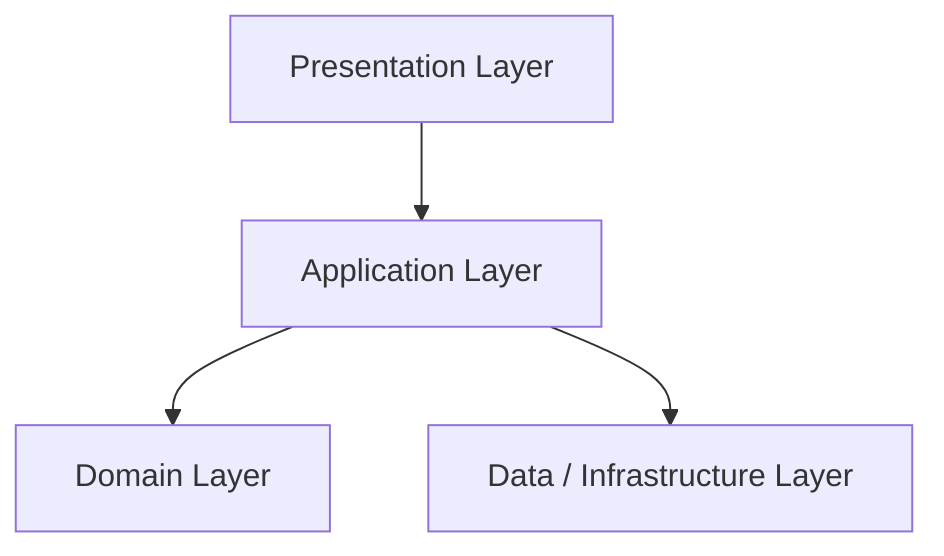

# AlphaForge AI Architecture

AlphaForge AI turns an investor profile into an explained, simulated portfolio recommendation. Every number in the explanation traces back to the data, trade-offs and limitations are always shown, and each run is saved to an audit trail. Everything is simulation material and nothing is investment advice.

Assumption: the datathon brief was not in the repository, so the scope below is inferred from the starter dataset (`dataset/`; original pack guide in `starter-dataset.md`). Adjust it once the brief and the final CSV files are confirmed.

## Scope split

| Part | Owner |
| --- | --- |
| Interactive questionnaire (including questions that assess risk level), questionnaire agent, matching users to profiles | Teammates |
| Recommendation pipeline, evidence-grounded explanations, trade-offs, limitations, compliance gate, S3 audit trail | This repo |

The two sides meet at the `InvestorProfile` contract (`investor-profile-schema.json`). Persona profiles will be added later as example inputs.

## Layered architecture



Dependency rule: dependencies point downward only. The Domain Layer imports nothing from the other layers. The Data / Infrastructure Layer implements interfaces (ports) that the Application Layer defines, so storage and AWS services can be swapped without touching business logic.

| Layer | Responsibility | Contents |
| --- | --- | --- |
| Presentation | Collect investor input, display results | Questionnaire UI (teammates), result view showing recommendation, trade-offs and limitations, API handlers |
| Application | Orchestrate the pipeline | Orchestrator, pipeline agents, evidence validator, compliance gate, ports (`PriceRepository`, `LLMClient`, `AuditStore`) |
| Domain | Pure business rules, no I/O | `InvestorProfile`, `Portfolio`, risk metrics, allocation and constraint rules, `EvidenceBundle`, `LimitationsRegistry` |
| Data / Infrastructure | Talk to the outside world | CSV loaders, Bedrock client, S3 audit store (and a local-folder store for development) |

## Request flow

See `pipeline.mmd` for the diagram and `agent-responsibilities.md` for each step.

1. The questionnaire (teammates) produces an `InvestorProfile`.
2. The orchestrator runs the Data, Screening, Risk, Portfolio and Backtest agents. These are deterministic Python and do not call the LLM.
3. The Domain Layer collects every computed number into an **Evidence Bundle**.
4. The Explanation Agent writes the rationale and trade-offs from the bundle only, citing evidence IDs.
5. The **Compliance Gate** validates evidence, the disclaimer, limitations, wording and constraints. Repairable explanation failures share at most 2 retries, followed by one deterministic template fallback checked by the same gate. Structural failures or a failed fallback return an explicit error. See `agents-workflow.md` for the bounded sequence.
6. The result goes to the UI together with the limitations. The whole run is written to S3.

## Design features

- **Evidence-grounded explanations:** the LLM sees only the Evidence Bundle, and a code validator rejects any number or citation that is not in it. This addresses invented figures.
- **Trade-offs:** the Portfolio Agent records each rejected alternative and the rule that rejected it. The explanation narrates those records.
- **Limitations:** the `LimitationsRegistry` generates the list in code, from fixed dataset caveats and from the actual data (window, missing history, data quality warnings). The LLM cannot omit it.
- **Audit trail:** each run saves its profile, data manifest (file hashes and window), evidence, decisions, LLM calls, compliance results and final result under `runs/{run_id}/` in S3.
- **Compliance gate:** final check before any output is shown.

## Implemented repository layout

```text
frontend/                        # Web presentation, assets and local HTTP proxy
backend/src/alphaforge/
    presentation/backtest_viewer.py  # Streamlit UI
    application/                 # Calculation orchestration; repository and LLM ports
    domain/                      # Pure allocation, policy, FX/calendar and backtest functions
    infrastructure/              # Local CSV/JSON repository; Bedrock adapter
    bootstrap.py                 # Composition root wiring local ports/adapters
backend/scripts/                 # Backend entry points and original starter build tools
backend/tests/                   # Offline backend tests
backend/pyproject.toml           # Python package configuration
backend/requirements.txt         # Python dependencies
scripts/                         # Project workflow checks
dataset/                         # All local CSV inputs; ignored by Git
profiles.json                    # Existing profile contract, retained at root
```

The web interface lives in `frontend/`. It sends raw questionnaire answers through optional HTTP adapters; a backend mapper to the investor schema and response contract is still required. The Streamlit viewer is a separate developer presentation of saved reference portfolios.

Application code depends on `PortfolioRepository` and Domain functions. `LocalPortfolioRepository` implements that port; `bootstrap.create_engine()` supplies the adapter. Domain imports no presentation, application or infrastructure code and performs no I/O. LLM ports and Bedrock retain their existing layer placement.

### Migration map

| Previous location | Current location |
| --- | --- |
| `plateforme/` | `frontend/` |
| `src/alphaforge/` | `backend/src/alphaforge/` |
| `tests/` | `backend/tests/` |
| Backend tools in `scripts/` | `backend/scripts/`; workflow checker stays in `scripts/` |
| `pyproject.toml`, `requirements.txt` | `backend/pyproject.toml`, `backend/requirements.txt` |
| `alphaforge_starter/dataset/*.csv` | `dataset/*.csv` |
| `alphaforge_starter/README.md` | Archived `docs/starter-dataset.md`; current instructions in `dataset/README.md` |
| `alphaforge_starter/build_dataset.py` | `backend/scripts/build_dataset.py` (separate rebuild output) |
| `historique_actifs_2011.csv` | `dataset/prices_weekly.csv` (current supplied replacement; columns selected by name) |
| `portfolio_engine.py` | `application/portfolio_engine.py` plus pure `domain/proposals.py` |
| `backtest_viewer.py` | `presentation/backtest_viewer.py`, `application/backtests.py`, `domain/backtest.py`, `domain/market_data.py`; launch via `backend/scripts/backtest_viewer.py` |
| `build_portfolios.py` | `domain/reference_portfolios.py`, `application/reference_portfolios.py`; launch via `backend/scripts/build_portfolios.py` |
| `risk.py` | `application/risk.py` (teammate-owned, still unimplemented) |
| `universe_v2.py` | `backend/scripts/universe_v2.py` (proposed universe) |

Python module paths in this table are under `backend/src/alphaforge/`. Existing callers must import `create_engine` from `alphaforge.bootstrap` and call its methods instead of importing root-level `portfolio_engine`. Numerical rules and `profiles.json` contents were preserved.

### Implemented versus planned

The code provides deterministic proposal assessment, reference builds/comparisons, local CSV/JSON storage and a Bedrock text adapter. The [proposal workflow](orchestrator.md) connects the Lambda handler to per-run local/S3 snapshots, the existing engine, structured evidence, bounded explanation ordering/repairs, deterministic release checks and local/S3 audit-before-release. It supports the explicit profile ID/change contract. The full questionnaire-to-recommendation flow above remains the target: questionnaire mapping, sector/ESG screening, teammate-owned per-ticker risk and frontend HTTP contract mapping remain pending. The template enables runtime storage only when its bucket and reviewed policy parameters are set; no deployment is implied by the code. The frontend's unconnected demonstration does not certify a recommendation. Strands role concepts in team notes are optional proposals; calculation stages remain deterministic.

The active 99-ticker price snapshot differs from the legacy profile universe; see [DATA.md](DATA.md) before running real-data validation. The original starter generator cannot reproduce the expanded history.

### Reorganization verification and development handoff

Inputs were the existing root Python modules, the supplied CSVs, unchanged `profiles.json`, the web presentation and these architecture notes. Financial rules, raw data contents and the profile JSON were preserved; module imports and developer launch commands changed as documented above.

| Role | Task and output | Checks and evidence | Status; next owner |
| --- | --- | --- | --- |
| Infrastructure (primary) | Wire repository port/local adapter and composition root; update paths and instructions | Default-path and explicit-path tests; SDK regressions; workflow checker; Python compilation and JS syntax checks | Complete for reorganization; API/infrastructure implementation owner next |
| Data | Move CSVs into `dataset/`, load renamed history, document actual coverage | Actual CSV header/inventory; fixture loader test; actual file load; `docs/DATA.md`; lesson L-006 | Complete for reorganization; data owner to reconcile universe/FX coverage |
| Portfolio | Separate pure policy/transformations from application orchestration | Synthetic caps/funding regressions; all-flat reference-build control; profile JSON has no diff | Complete for reorganization; portfolio owner to agree compatible holdings before regeneration |
| Risk | Relocate teammate-owned contract and preserve metric conventions | Existing expected-failure tests remain; metric regressions pass | Complete for relocation; teammate owns per-ticker implementation |
| Backtest | Extract pure accounting/metrics and application comparison from viewer | Month-boundary gain/loss and hand-computable accounting regressions | Complete for extraction; presentation owner can use new launcher |

The offline suite returned **48 passed, 8 skipped, 2 xfailed; 17 subtests passed**. The eight legacy real-data tests skip because required tickers are absent; the two expected failures concern the unimplemented per-ticker risk contract. Pytest reported one cache-directory permission warning on the successful run. The workflow structural checker passed for nine role files and six lessons; its eight self-tests also passed. Real-file checks confirmed the renamed CSV loads, missing holdings return `MISSING_INFO`, and available TSLA history computes a policy conflict. Local documentation links resolved. These are deterministic checks, not an independent review or a complete production-pipeline validation. No data downloads, profile regeneration, live AWS calls or deployment occurred.

## Data handling rules (from the starter dataset)

- Use `adj_close` for returns. Prices are in listing currency (`.TO` is CAD, others USD). Convert with `fx_usdcad_daily.csv`.
- Align calendars explicitly (TSX, U.S. and 7-day crypto) and record the method in the data manifest.
- Do not use monthly macro values before their publication date in backtests.
- The universe has survivorship bias. The limitations list states this on every result.
- The data has no ESG scores or fundamentals. The limitations list says so, and no ESG claim is made without a documented outside source.
- The supplied local CSVs are listed in `dataset/README.md`. The active loader uses `prices_weekly.csv` and `fx_usdcad_daily.csv`. A manifest-driven production pipeline and generated evidence IDs remain planned.

## Cross-cutting concerns

- **Disclaimers:** every output carries a "simulation, not investment advice" statement.
- **Security:** least-privilege IAM, no secrets in code, input validation at the Presentation boundary.
- **Testing:** the Domain Layer is pure, so it can be unit-tested without mocks. Persona profiles, once added, serve as end-to-end test inputs.

See `aws-services.md` for the reduced AWS stack (Lambda, Bedrock, S3) and `diagrams/architecture.png` for the layer diagram.
