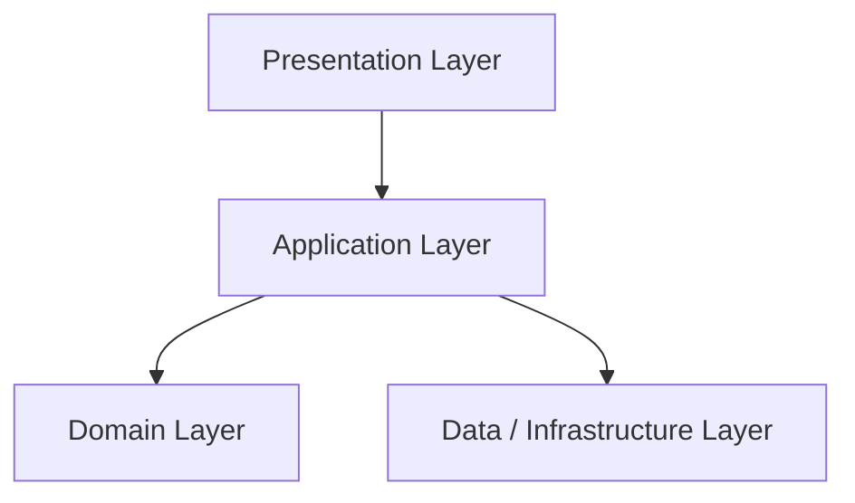

# AlphaForge AI Architecture

AlphaForge AI turns an investor profile into an explained, simulated portfolio recommendation. Every number in the explanation traces back to the data, trade-offs and limitations are always shown, and each run is saved to an audit trail. Everything is simulation material and nothing is investment advice.

Assumption: the datathon brief was not in the repository, so the scope below is inferred from the starter dataset (`alphaforge_starter/`). Adjust it once the brief and the final CSV files are confirmed.

## Scope split

| Part | Owner |
| --- | --- |
| Interactive questionnaire (including questions that assess risk level), questionnaire agent, matching users to profiles | Teammates |
| Recommendation pipeline, evidence-grounded explanations, trade-offs, limitations, compliance gate, S3 audit trail | This repo |

The two sides meet at the `InvestorProfile` contract (`investor-profile-schema.json`). Persona profiles will be added later as example inputs.

## Layered architecture



Dependency rule: dependencies point downward only. The Domain Layer imports nothing from the other layers. The Data / Infrastructure Layer implements interfaces (ports) that the Application Layer defines, so storage and AWS services can be swapped without touching business logic.

| Layer | Responsibility | Contents |
| --- | --- | --- |
| Presentation | Collect investor input, display results | Questionnaire UI (teammates), result view showing recommendation, trade-offs and limitations, API handlers |
| Application | Orchestrate the pipeline | Orchestrator, pipeline agents, evidence validator, compliance gate, ports (`PriceRepository`, `LLMClient`, `AuditStore`) |
| Domain | Pure business rules, no I/O | `InvestorProfile`, `Portfolio`, risk metrics, allocation and constraint rules, `EvidenceBundle`, `LimitationsRegistry` |
| Data / Infrastructure | Talk to the outside world | CSV loaders, Bedrock client, S3 audit store (and a local-folder store for development) |

## Request flow

See `pipeline.mmd` for the diagram and `agent-responsibilities.md` for each step.

1. The questionnaire (teammates) produces an `InvestorProfile`.
2. The orchestrator runs the Data, Screening, Risk, Portfolio and Backtest agents. These are deterministic Python and do not call the LLM.
3. The Domain Layer collects every computed number into an **Evidence Bundle**.
4. The Explanation Agent writes the rationale and trade-offs from the bundle only, citing evidence IDs.
5. The **Compliance Gate** validates the evidence citations, the disclaimer, the limitations list, the wording and the constraints. On failure it retries the Explanation Agent up to 2 times, then returns an explicit error.
6. The result goes to the UI together with the limitations. The whole run is written to S3.

## Design features

- **Evidence-grounded explanations:** the LLM sees only the Evidence Bundle, and a code validator rejects any number or citation that is not in it. This addresses invented figures.
- **Trade-offs:** the Portfolio Agent records each rejected alternative and the rule that rejected it. The explanation narrates those records.
- **Limitations:** the `LimitationsRegistry` generates the list in code, from fixed dataset caveats and from the actual data (window, missing history, data quality warnings). The LLM cannot omit it.
- **Audit trail:** each run saves its profile, data manifest (file hashes and window), evidence, decisions, LLM calls, compliance results and final result under `runs/{run_id}/` in S3.
- **Compliance gate:** final check before any output is shown.

## Proposed repository layout

```
RecommenDathon/
├── alphaforge_starter/        # existing starter dataset and build script
├── docs/                      # this documentation
└── src/alphaforge/
    ├── presentation/          # UI, API handlers, request/response schemas
    ├── application/           # orchestrator, agents, evidence validator, compliance gate, ports
    ├── domain/                # entities, risk and allocation rules, evidence, limitations
    └── infrastructure/        # CSV repositories, Bedrock client, S3 and local audit stores
```

## Data handling rules (from the starter dataset)

- Use `adj_close` for returns. Prices are in listing currency (`.TO` is CAD, others USD). Convert with `fx_usdcad_daily.csv`.
- Align calendars explicitly (TSX, U.S. and 7-day crypto) and record the method in the data manifest.
- Do not use monthly macro values before their publication date in backtests.
- The universe has survivorship bias. The limitations list states this on every result.
- The data has no ESG scores or fundamentals. The limitations list says so, and no ESG claim is made without a documented outside source.
- The final CSVs are still to come. The pipeline reads whatever files the data manifest lists, so evidence IDs are generated, not hard-coded.

## Cross-cutting concerns

- **Disclaimers:** every output carries a "simulation, not investment advice" statement.
- **Security:** least-privilege IAM, no secrets in code, input validation at the Presentation boundary.
- **Testing:** the Domain Layer is pure, so it can be unit-tested without mocks. Persona profiles, once added, serve as end-to-end test inputs.

See `aws-services.md` for the reduced AWS stack (Lambda, Bedrock, S3) and `diagrams/architecture.png` for the layer diagram.
